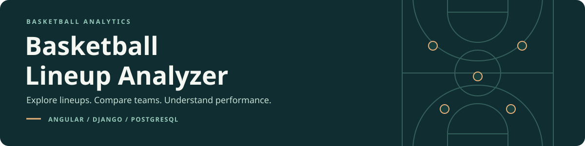
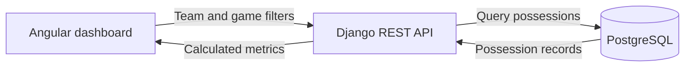

  

  <strong>A full-stack basketball analytics dashboard built with Angular, Django REST Framework, and PostgreSQL.</strong>

  <a href="#what-you-can-explore">Features</a> ·
  <a href="#nba-sample">NBA game</a> ·
  <a href="#how-it-works">Architecture</a> ·
  <a href="#inside-the-analytics">Methodology</a>

---

Basketball Lineup Analyzer turns possession-level data into team comparisons, player ratings, and five-player lineup recommendations. Explore a real Philadelphia–New York game or switch to the fictional demo, then choose a team and explore the numbers behind its performance.

## What you can explore

| Feature | What it shows |
| :--- | :--- |
| **NBA and demo datasets** | Philadelphia vs. New York from the 2026–27 NBA season, alongside a separate fictional dataset. |
| **Team comparisons** | Interactive charts comparing offensive, defensive, and net ratings across teams. |
| **Lineup recommendations** | Five-player groups ranked for scoring, rebounding, and overall performance, with an adjustable minimum possession count. |
| **Player on-court ratings** | How teams perform with each player on the floor, ranked by net rating. |
| **Game breakdowns** | Game-specific rosters, shooting efficiency, rebounding, turnovers, tempo, and fourth-quarter performance. |
| **API Explorer** | The JSON results behind the dashboard, including observed 1–5-player combinations. |

## How it works

The backend groups players into observed lineup combinations, totals their possession statistics, and calculates performance metrics. The frontend presents those results through filters, charts, and recommendation cards.

| Layer | Built with |
| :--- | :--- |
| **Interface** | Angular · TypeScript · Angular Material · AG Charts |
| **Analytics & API** | Python · Django · Django REST Framework |
| **Database** | PostgreSQL |
| **Deployment configuration** | Docker · Gunicorn · WhiteNoise · Railway |

## Inside the analytics

- **Comparable ratings.** Offensive and defensive ratings measure points per 100 possessions; net rating is their difference.
- **Direct team aggregation.** Team summaries use the underlying possessions instead of averaging lineup ratings.
- **Explicit ranking rules.** Overall lineup recommendations use net rating. Rebounding recommendations combine offensive and defensive rebound percentages, with net rating breaking ties.
- **Careful interpretation.** Player ratings describe team performance while a player is on court. They do not isolate an individual's contribution from teammates and opponents.

## The datasets

Use the dataset selector to switch between the fictional demo and a real NBA game. Their statistics are kept separate.

### NBA sample

**Philadelphia 76ers 106 — 100 New York Knicks**

October 20, 2026 · 2026–27 regular season · New York home game

| Play-by-play events | Completed possessions | Observed five-player lineups | Players who appeared |
| :---: | :---: | :---: | :---: |
| **557** | **204** — 102 per team | **36** | **19** |

Choose **NBA · 2026–27** in the dashboard to compare the two teams, explore player on-court ratings, and see which lineups performed best in this game. NBA lineup recommendations start with a minimum of five offensive and five defensive possessions; the filter lets you explore different sample sizes.

The importer reconstructs lineups from play-by-play events and substitutions. Team totals, player minutes, and every participating player's plus/minus are validated against the box score before the game is imported.

Sources: [NBA.com box score](https://www.nba.com/game/phi-vs-nyk-0022600002/box-score) · [NBA.com play-by-play](https://www.nba.com/game/phi-vs-nyk-0022600002/play-by-play). The [saved game data](backend/raw_data/nba/2026-27/0022600002/) is included in the repository for repeatable imports and tests.

### Fictional demo

| Possessions | Observed five-player lineups | Games | Fictional teams |
| :---: | :---: | :---: | :---: |
| **1,348** | **227** | **7** | **3** |

The sample includes 60 player records, with 48 players appearing in possession data. Teams include **The Avengers**, **Justice League**, and **Tune Squad**.

> Both datasets are small samples. The NBA sample covers one game, not a season; the fictional fixtures are not official league data. Extreme ratings can come from very few possessions, and tied ratings do not imply a unique best lineup.

## Tests

The project includes **33 automated tests** covering derived metrics, zero-denominator handling, dashboard routing, NBA conversion and box-score reconciliation, dataset isolation, and repeatable imports.
